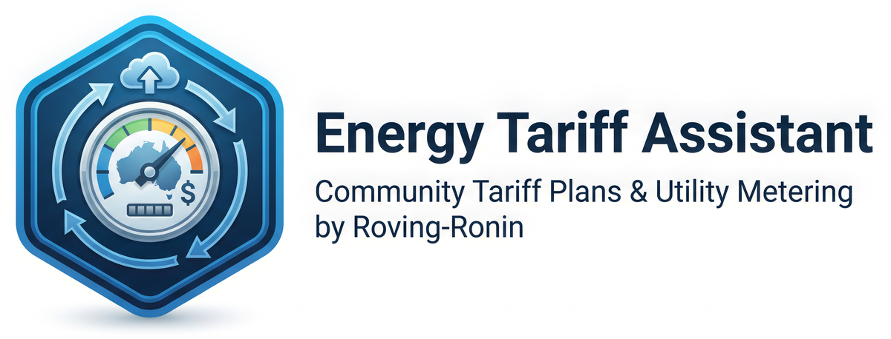

<p align="center"></p>

[![Marketplace][marketplace-badge]][marketplace-url]
[![release][release-badge]][release-url]
[![downloads][downloads-badge]][release-url]
[![stars][repo-stars-badge]][repo-url]
[![license][license-badge]][license-url]
[![installs][installs-badge]][installs-url]

[![maintained][maintained-badge]][commits-url]
[![activity][activity-badge]][commits-url]
[![Validate][validate-badge]][validate-url]
[![Tests][tests-badge]][tests-url]

___

> [!WARNING]
> **Under development: please don't install this yet.** Energy Tariff Assistant is being built and tested.
> Entities, settings and stored meter totals may change or be reset between versions without a migration.
> Watch or star the repository to hear when the first stable release is out.

A Home Assistant custom integration for Australian electricity tariff plans, **with metering built in**.
Pick your plan once (from the shared library, a file, or pasted JSON), choose your grid import and export
energy sensors, and get:

- the **price and period in force** now, and a **price forecast** in the format HAEO and EMHASS use,
- **kWh and $ per rate** (peak, shoulder, off-peak, free...), today and this billing cycle,
- the **supply charge** accrued, and an **estimated bill** for the cycle, after feed-in credits.

It replaces the usual pile of `input_number` rates, time helpers, a template price sensor, a `utility_meter`
with tariffs, and the automations that switch them at every period boundary. Change plans and you pick a new
plan; the meters carry on.

> **Status: v0.1.** Time-of-use import, feed-in (flat, time-of-use or capped), daily supply charge,
> public holidays, and per-rate metering are working and tested. Demand charges and controlled-load
> circuits are in the plan format and the rate engine, but don't have entities yet.

## Installation

Energy Tariff Assistant isn't in the default list yet, so add it as a custom repository first.

### Marketplace (Home Assistant 2026.11 and newer)

[![Open this repository in the Marketplace][marketplace-button]][marketplace-url]

Or add it manually:

1. Go to **Settings → Marketplace**, open the ⋮ menu and choose **Custom repositories**
2. Add `https://github.com/Roving-Ronin/energy-tariff-assistant` as an **Integration**
3. Search for **Energy Tariff Assistant** and click **Download**
4. Restart Home Assistant, then go to **Settings → Devices & services → Add integration → Energy Tariff Assistant**

### HACS (Home Assistant 2026.10 and older)

[![Open this repository in HACS][hacs-button]][hacs-url]

Or add it manually:

1. Open **HACS**, open the ⋮ menu and choose **Custom repositories**
2. Add `https://github.com/Roving-Ronin/energy-tariff-assistant` as an **Integration**
3. Search for **Energy Tariff Assistant** and click **Download**
4. Restart Home Assistant, then go to **Settings → Devices & services → Add integration → Energy Tariff Assistant**

Needs Home Assistant 2026.2 or newer.

## Setup

Add one entry per metering point: usually just your main meter. (Controlled load gets its own entry once it's
supported.)

1. **Name and plan source.** The name is used for the device and entity names (`Electricity` gives
   `sensor.electricity_import_price`). Then choose where the plan comes from:
   - **Shared plan library:** browse it first in the [plan browser][plan-browser] if you like. Then narrow it down step by step (customer type and country, state, distributor (DNSP),
     retailer) and pick the plan, newest first. Residential, Australia and NSW are picked to start with; plans
     that don't say whether they're residential or business are shown for both. Internet is needed only during
     setup; the plan is stored with the entry.
   - **Build a plan step by step:** enter it from your bill or the plan's fact sheet (BPID): state, distributor,
     retailer, plan name, start date, daily supply charge and customer type (residential or business); then import and feed-in, each either one rate all
     the time or time of use. For time of use you enter the rate for *all other times* first (often Shoulder),
     then each timed period (e.g. Peak, weekdays 15:00-21:00), with more than one time per period if needed.
     Any rate can have a cap ("first 50 kWh a day free, then Shoulder"; "first 10 kWh at 12c, then 4c"), resetting
     each day, month or billing cycle. You check a summary before saving. The plan is saved to
     `energy_tariff_assistant/plans/` in your config folder (never overwriting a file) and can be shared with the
     library afterwards.
   - **Paste plan JSON:** paste a plan file (see *Plan format* below).
   - **Plan file in my config folder:** a path relative to your config folder, e.g. `tariffs/my-plan.json`.
2. **Energy meters.** Choose the cumulative energy sensors for **grid import** and **grid export**
   (kWh, Wh or MWh; `total` or `total_increasing`, the same ones you'd give the Energy dashboard), and the
   **day of the month your billing cycle starts** (1-28). Leave a sensor empty to get prices only for that side.

To change sensors or the billing day, or to switch plans: **Settings → Devices & services → Energy Tariff
Assistant → Configure**. Switching plans keeps the meters: periods with the same id (e.g. `peak`) carry on, and
new periods get new entities.

## What you get

With a device named `Electricity` (entity IDs follow your name and the plan's period names):

| Entity | What it is |
| --- | --- |
| `sensor.electricity_import_price` | Price now, `AUD/kWh`. Use it as the Energy dashboard price entity. Attributes: period, tier, and `forecast` (next 2 days) |
| `sensor.electricity_export_price` | Feed-in price now |
| `sensor.electricity_import_period` / `_export_period` | Period in force now, e.g. `Peak` |
| `sensor.electricity_import_next_period_change` / `_export_…` | When the period next changes, and to what |
| `sensor.electricity_daily_supply_charge` | The plan's daily supply charge |
| `sensor.electricity_import_energy_today` / `_this_billing_cycle` | kWh bought, all periods |
| `sensor.electricity_import_cost_today` / `_this_billing_cycle` | What that energy cost |
| `sensor.electricity_import_<period>_energy_today` / `_this_billing_cycle` | kWh bought in one period, e.g. `…_import_peak_energy_today` |
| `sensor.electricity_import_<period>_cost_today` / `_this_billing_cycle` | What that period's energy cost (attribute `average_rate`) |
| `sensor.electricity_export_…_energy_…` / `…_credit_…` | The same for feed-in: kWh exported and the credit earned |
| `sensor.electricity_supply_charge_today` / `_this_billing_cycle` | Supply charge for the days so far |
| `sensor.electricity_estimated_bill_this_billing_cycle` | Import cost + supply charge − feed-in credit. Attributes show the three parts |

Every meter also shows `last_period` (the value when the previous day or cycle ended), `source` and
`source_available`. The meters are `state_class: total` with `last_reset` at the start of the day or cycle,
so long-term statistics work.

### Actions

- **`energy_tariff_assistant.calibrate`**: set a per-period meter (e.g. *Import Peak energy this billing cycle*)
  to a value, to line up with your bill. Give `cost` too, or it's scaled to keep the same average rate.
- **`energy_tariff_assistant.reset_meters`**: start a new day or billing cycle now, for every meter of an entry.
  Useful when your bill period moves.

To share your plan with the library, see *Adding a plan to the library* below.

## What the numbers mean (and don't)

**They are estimates measured in Home Assistant, not your bill.** They come from your own energy sensors, on
Home Assistant's clock, and won't match the retailer's figures to the cent. Smart-meter data is in 30-minute
intervals and the retailer rounds per line item; your inverter or CT clamp measures differently.

How energy is shared between periods: the energy between two readings is taken as used evenly over the time
between them. When a period boundary (or midnight) falls in between, the energy is split in proportion to the
time either side, and each part is priced at its own rate. `utility_meter` with tariffs instead gives the whole
increase to whichever tariff is selected when the reading arrives, so a slow-updating sensor can put minutes of
shoulder energy into peak. If Home Assistant was stopped, the energy used meanwhile is spread over the time it
was down.

Caps are split exactly: with "first 50 kWh/day free from 11:00 to 14:00, then shoulder", the 50th kWh is free and
the 51st is charged at shoulder, both counted in the *Free* period's kWh. The price sensor changes to the
shoulder rate as soon as the cap is used up.

A drop of under 1% in a source reading is ignored as sensor jitter; a bigger drop is taken as the meter
resetting to zero.

The supply charge counts whole days, including today. The bill sensor doesn't include demand charges,
discounts, concessions or controlled load yet.

## Plan format in brief

A plan is one JSON file (`"format": "ha_tariff_plan"`, `"version": 1`). Rates include GST, per kWh, in dollars.
Each of `import`, `export` and any `controlled_load` has a list of periods; one period is the `default` and covers
any time no other window claims.

```json
{ "id": "free", "name": "Free",
  "windows": [{ "days": "all", "start": "11:00", "end": "14:00" }],
  "tiers": [{ "up_to_kwh": 50, "rate": 0.0 }, { "use_period": "shoulder" }],
  "tier_reset": "day" }
```

- **Windows**: `days` is `all`, `weekdays`, `weekends` or a list like `["mon","tue"]`. `start` is inclusive,
  `end` exclusive. An end before the start wraps past midnight, matched by calendar day: "weekdays 22:00-07:00"
  covers Monday 00:00-07:00 but not Saturday 00:00-07:00. Use `"all_day": true` rather than `00:00`-`00:00`.
- **Tiers** express caps and stepped rates. The last tier always says what happens after the cap (`rate`, which
  can be 0, or `use_period`). `tier_reset` is `day`, `month` or `bill` (your billing cycle).
- **Holidays**: `"holidays": {"treat_as": "sunday"}` treats public holidays (from `python-holidays`, by state)
  as Sundays.
- **Seasons**, **demand charges** and **controlled load** are supported in the format; see
  [`schema/tariff-plan.schema.json`](custom_components/energy_tariff_assistant/schema/tariff-plan.schema.json).

See [`plans/AU/NSW/CovaU-SolarMaxTOU-NSW-EssentialEnergy-20260701.json`](plans/AU/NSW/CovaU-SolarMaxTOU-NSW-EssentialEnergy-20260701.json)
for a complete example.

## Adding a plan to the library

The [plan browser][plan-browser] shows every library plan with its times on a 24-hour timeline, its rates and
caps, and anything the validator found; **Report a problem** on a plan opens a correction with the plan filled in.
Its **Coverage** page shows which distributors have no library plans yet.

**From Home Assistant:** Settings → Devices & services → Energy Tariff Assistant → **Configure** → **Share this
plan with the plan library**. It opens the [plan submission form][plan-form] on GitHub with the plan filled in
(rates, times, retailer and region only; nothing about your home, meters or usage). Nothing is sent from Home
Assistant: you check the form and submit it from your own GitHub account. A plan too long for a link is shown
for you to copy and paste into the form.

Don't want to write JSON? Use the [plan submission form][plan-form] with your plan's details (the BPID or
Energy Made Easy page is the easiest source).

Or, as a pull request:

1. Write the plan file (or convert one: `python scripts/import_energy_manager.py --write <file>`).
2. Put it at `plans/<country>/<region>/<Retailer>-<PlanSlug>-<Region>-<DNSP>-<YYYYMMDD>.json`.
3. Run `python scripts/validate_plans.py` and `python scripts/build_index.py`.
4. Open a pull request. The Plans workflow re-runs both checks.

## Development

```
pip install -r requirements_test.txt
bash scripts/fetch_fixtures.sh   # importer fixtures from energy-manager-tariffs
python -m pytest
```

| Path | What it is |
| --- | --- |
| `custom_components/energy_tariff_assistant/engine/` | Rate engine and metering: plan model, resolver, forecast, validator, ledger. No Home Assistant imports, so the plan scripts and CI use it directly. |
| `custom_components/energy_tariff_assistant/` | The integration: config flow, runtime (state tracking, timers, storage), sensors. |
| `plans/` | Shared plan library, plus a generated `index.json`. |
| `scripts/` | `validate_plans.py`, `build_index.py`, `import_energy_manager.py`, `fetch_eme_retailers.py` (see *Retailer coverage*). |
| `tests/` | Engine tests (run with just `holidays`, `jsonschema`, `pytest`). |
| `tests_ha/` | Integration tests with `pytest-homeassistant-custom-component`. |

The importer tests use plan files from energy-manager-tariffs. They are fetched rather than committed because
that repository has no licence file; without them those tests are skipped.

### Retailer coverage

`plans/retailers.json` lists which retailers sell electricity in which distributor (DNSP) areas and states, with
plan counts. The **Retailer coverage** workflow rebuilds it weekly with `scripts/fetch_eme_retailers.py` from the
AER's [Energy Product Reference Data](https://www.aer.gov.au/energy-product-reference-data) (Energy Made Easy,
Consumer Data Right; Victorian plans come from DEECA), and commits it when it changes. Only derived facts are
stored: retailer, distributor, state and counts, no plan text or prices. WA and the NT aren't in that data.

### Importing plans from Energy Made Easy

**Actions → Import plans → Run workflow** converts current Energy Made Easy plans for the distributors you give
(e.g. `Ausgrid, Endeavour Energy, Essential Energy`), customer type and pricing, validates them and opens a pull
request adding the ones that pass, each marked `needs_review: true`. Plans already in the library are left alone.
It needs **Settings → Actions → General → Allow GitHub Actions to create and approve pull requests**. GitHub asks
before running checks on a pull request opened by the bot: click **Approve and run workflows** on it.

### Synergy plans (WA)

WA isn't on Energy Made Easy. `scripts/fetch_synergy_plans.py` reads the price tables on Synergy's four plan pages
(Home Plan A1, Midday Saver, EV Add On, Home Business Plan K1) and the DEBS feed-in schedule. Every rate label and
stated time is checked against what the plan expects; anything unexpected stops it with the reason and changes
nothing.

synergy.net.au refuses GitHub's servers, so it isn't scheduled. Run it from a home connection when prices change
(normally 1 July; the Horizon Power workflow opens an issue when WA's tariffs change):

```bash
pip install -r requirements_test.txt pypdf
python scripts/fetch_synergy_plans.py                    # fetch from Synergy's site and write the plans
python scripts/fetch_synergy_plans.py --from ~/synergy   # or: pages saved from a browser
```

For `--from`, save each of the four plan pages with your browser's **Save page as… → Webpage, single file
(.mhtml)**, plus the DEBS pricing schedule PDF, into one folder. Then open a pull request with the new plan files.

### Horizon Power plans (regional WA)

The **Horizon Power plans (WA)** workflow runs weekly on Horizon Power's pricing page. Prices are the WA
Government's uniform tariffs, but feed-in depends on the town, so each of the 37 towns gets an **A2 Residential**
plan with DEBS (solar up to 5 kW) and one with **Buyback Bonus** (over 5 kW, Community Wave members, summer and
winter rates), plus one **K2 Combined Use** plan (no feed-in). REBS (closed) and the other tariffs are left out.
A2 and K2 are the same government tariffs as Synergy's A1 and K1, so when they change the workflow opens one issue
asking for the Synergy plans to be updated.

### Plan browser

The [plan browser][plan-browser] is a static page in `site/` (plain HTML, CSS and JavaScript). The **Plan browser**
workflow builds it with `scripts/build_site.py` (the page, the library plans, their validation results and the
retailer coverage) and publishes it to GitHub Pages whenever `plans/`, `site/` or the scripts change on `main`.
To try it locally: `python scripts/build_site.py --out /tmp/site && python -m http.server -d /tmp/site`.

### Releasing

Merge a PR titled with its version (e.g. `v0.2.0: demand charges`) and with a `## v0.2.0 (YYYY-MM-DD)` section in
`CHANGELOG.md`: the Auto Release workflow publishes the release, writes the version into `manifest.json`, attaches
`energy_tariff_assistant.zip` and commits the version back to `main`. **`[skip release]`** in the PR title, or on a line of
its own in the description, merges without releasing (a sentence that only mentions it doesn't count).

## Licence

GPL-3.0. See `LICENSE`.

<!-- Badges -->
[marketplace-badge]: https://img.shields.io/badge/Marketplace%20-%20Custom-orange?style=flat-square
[release-badge]: https://img.shields.io/github/v/release/Roving-Ronin/energy-tariff-assistant?style=flat-square&color=blue&label=Release
[downloads-badge]: https://img.shields.io/github/downloads/Roving-Ronin/energy-tariff-assistant/total?style=flat-square&label=Downloads
[installs-badge]: https://img.shields.io/badge/dynamic/json?color=41BDF5&logo=home-assistant&label=integration%20usage&suffix=%20installs&cacheSeconds=15600&url=https://analytics.home-assistant.io/custom_integrations.json&query=$.energy_tariff_assistant.total&style=flat-square
[maintained-badge]: https://img.shields.io/badge/Maintained-yes-brightgreen?style=flat-square
[activity-badge]: https://img.shields.io/github/commit-activity/y/Roving-Ronin/energy-tariff-assistant?style=flat-square&label=Commit%20Activity
[license-badge]: https://img.shields.io/github/license/Roving-Ronin/energy-tariff-assistant?style=flat-square&label=License
[repo-stars-badge]: https://img.shields.io/github/stars/Roving-Ronin/energy-tariff-assistant?style=flat-square&logo=github&label=Repo%20Stars
[validate-badge]: https://img.shields.io/github/actions/workflow/status/Roving-Ronin/energy-tariff-assistant/validate.yaml?branch=main&label=Validate&style=flat-square
[tests-badge]: https://img.shields.io/github/actions/workflow/status/Roving-Ronin/energy-tariff-assistant/tests.yaml?branch=main&label=Tests&style=flat-square

<!-- Buttons -->
[marketplace-button]: https://my.home-assistant.io/badges/marketplace_repository.svg
[marketplace-url]: https://my.home-assistant.io/redirect/marketplace_repository/?owner=Roving-Ronin&repository=energy-tariff-assistant&category=integration
[hacs-button]: https://my.home-assistant.io/badges/hacs_repository.svg
[hacs-url]: https://my.home-assistant.io/redirect/hacs_repository/?owner=Roving-Ronin&repository=energy-tariff-assistant&category=integration

<!-- Links -->
[repo-url]: https://github.com/Roving-Ronin/energy-tariff-assistant
[release-url]: https://github.com/Roving-Ronin/energy-tariff-assistant/releases
[installs-url]: https://analytics.home-assistant.io/custom_integrations.json
[commits-url]: https://github.com/Roving-Ronin/energy-tariff-assistant/commits/main
[validate-url]: https://github.com/Roving-Ronin/energy-tariff-assistant/actions/workflows/validate.yaml
[tests-url]: https://github.com/Roving-Ronin/energy-tariff-assistant/actions/workflows/tests.yaml
[license-url]: https://github.com/Roving-Ronin/energy-tariff-assistant/blob/main/LICENSE
[plan-form]: https://github.com/Roving-Ronin/energy-tariff-assistant/issues/new?template=plan_submission.yml
[plan-browser]: https://roving-ronin.github.io/energy-tariff-assistant/
